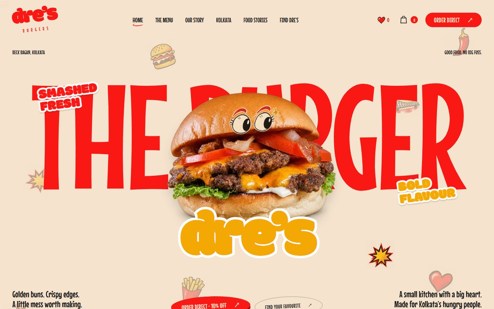

# Dre's Burgers · Kolkata

An animated restaurant website with a searchable menu, a persistent burger bag, and stories from Kolkata. Built with React, Vite and GSAP.



### Deployment

Vercel builds this project with `npm run build` and serves `dist/`. The root `vercel.json` supports direct links to the application routes. No environment variables are required for the current website.

The checkout is a preview: it calculates an estimate and reviews entered details, but does not take payment, submit orders or book delivery. Original-host video players and the map require network access. See [asset attribution](docs/attribution.md) for sources and license notes.

Artwork masters, research captures, local agent settings and test output remain local and are excluded from Git and deployment. The implementation and development notes below describe the website's revisions; referenced `research/`, `output/` and `art-masters/` folders are local archives.

---

A six-page React + Vite website, based on the supplied CRAV design reference and adapted to Dre's Burgers in Beck Bagan, Kolkata. It combines actual business/menu photography, original-host video embeds, hand-drawn illustration and coordinated GSAP scroll storytelling. The rejected 3D burger is removed, along with its runtime dependency.

## Run

```sh
npm install
npm run dev -- --port 5177
```

Open http://localhost:5177/.

Content routes: `/`, `/menu`, `/story`, `/kolkata`, `/stories`, `/visit`. Commerce routes: `/cart`, `/checkout`. The menu supports search, filters, details, saved cravings, allowed add-ons and a persistent burger bag. The checkout preview applies the approved 10% direct-order discount to food and add-ons. Payments, order creation and delivery booking are not connected; the real Zomato destination remains available. Call and directions links use verified public business information.

## Build and verify

```sh
npm run build
npm run preview -- --port 4173
node scripts/verify.mjs
```

The browser verification script uses locally installed Chrome. Set SITE_URL to point it at another local port. Screenshots and results are written to output/verification. Tests cover routes, menus, favorites, dialogs, keyboard Escape, video player insertion/unmounting, motion control, a photographic slider at three scroll positions, 390px and 768px layouts, images and application errors.

Netlify-style SPA redirects and a Vercel rewrite are included. Deployment must serve index.html for non-asset application routes.

## Editing content

- src/data/brand.js: verified business details, menu, photo credits and video URLs.
- src/App.jsx: page layouts and interactive controls.
- src/components/ScrollStory.jsx: layered photographic hero, red food scene, full-bleed first-bite scene and floating ingredients.
- src/components/PortraitJourney.jsx: seven-photo scroll story with cached geometry, one master timeline, previous/next controls and accessible dots; reduced motion becomes a native horizontal gallery.
- src/components/CityWorld.jsx and FounderWorkbench.jsx: full-colour Kolkata paper world and source-based founder work-photo collage.
- src/commerce/: catalog-based cart pricing, persistence, offer settings and preview checkout.
- src/components/scroll-story.css: independent scene compositions for desktop and phone.
- src/components/Sketch.jsx: reusable doodles and artwork.
- src/styles.css: exact reference palette and self-hosted fonts, plus responsive and reduced-motion styles.

The public business listing reports conflicting hours across sources; the website uses 'Call for today's timings.' Menu prices are identified as listed prices. Direct checkout shows a food-only estimate; delivery and applicable charges require integration. Video availability is controlled by its original host, which can require sign-in. There is a direct source link for each embed.

Research and attribution are recorded in research/business-sources.json, research/media-downloads.json and research/asset-manifest.md. Image-generation prompts and local output paths are in research/image-prompts.md. The original single-page reference implementation is preserved in output/reference.


## Kolkata rebuild

Seven AI-created campaign portraits are labelled as fictional scenes; they do not depict actual customers or Andre. Real Dre's photography remains credited separately. Two city photographs include creator, source and license links in a collapsible archive. The founder collage now uses two actual work photographs from public Dre's business posts, edited with imagegen. Four business videos use their actual post thumbnails and original-host players. A personal couple/profile photo and its generated treatment were rejected and excluded from deployable assets.

New assets (PNG masters and WebP delivery copies): public/assets/kolkata/. Generated with the built-in imagegen tool. Prompt sets: research/phase-2-art-prompts.json and research/phase-3-portrait-prompts.json. Source records: research/kolkata-city-photos.json. Motion audit and phase notes: research/six-phase-rebuild.md.

New components: KolkataExperience.jsx and kolkata-experience.css handle the seven-frame scroll story, city postcards, campaign contact sheet and founder feed. OpeningSequence.jsx provides a short, skippable, once-per-session opening. Navigation and photo/video dialogs animate both in and out. Reduced motion bypasses the opening and uses a touch/keyboard-accessible native gallery.


## Menu accuracy and ingredient motion update

The 16-item catalog now comes from the original Zomato page state, including full descriptions and listed add-ons. src/data/menu.js stores exact item/photo mappings. Fourteen items have a listed photo; two show labelled photo-pending cards. Imagegen edits are switchable to their original photographs, with extra source photos available in item details. Generic catalog artwork has been removed.

src/components/MenuProduct.jsx manages photo comparison. src/components/BurgerMotion.jsx provides scroll-controlled ingredient assembly and a bouncing, clickable footer lineup. The hero/opening use real Dre’s food sources, and a new Kolkata illustration appears in these scenes. New assets and full evidence are documented in research/menu-upgrade.md.

Additional validation: node scripts/verify-menu-rebuild.mjs. Very tall full-page captures in the general verification script are limited to the first 14,000 pixels to stay within browser screenshot limits; dedicated assembly/footer/mobile captures cover the new scenes.

## Contrast, founder and commerce update

The v4 full-colour repeated city backdrop and red assembly direction were rejected by the user and are no longer loaded. The current homepage restores the earlier mustard gallery, original illustrated photo borders, tram journey and mustard ingredient stage. `src/homepage-restored.css` holds the restored compositions; `src/artwork.css` holds shared asset-rendering/performance rules. Decorative doodles use generated artwork; functional UI icons and layout waves remain native shapes. Preserve the established homepage direction in future refinements.

The user-approved discount is configured in src/commerce/CartContext.jsx. Cart storage contains catalog IDs, quantities and allowed add-on names only. Checkout contact/address fields remain in page memory. Before enabling commerce, add server-authoritative prices, eligibility and totals, an order API, a payment gateway and verified Shiprocket/local-delivery coverage and charges.

Run `node scripts/verify-commerce-v4.mjs` for cart/checkout and founder checks and `node scripts/check-motion-v4.mjs` for native-wheel diagnostics and last-item Undo. Run `node scripts/check-layouts.mjs` for all eight routes at 390, 768 and 1440px. New artwork, source records, skill applications and validation are documented in research/contrast-founder-commerce-v4.md. All generated PNG masters and WebP delivery assets are saved in this workspace.

## Homepage restoration and founder work scenes

The approved founder paper-cut collage and all homepage video sources are preserved. The city chapter has returned to the quiet cream postcard layout and now pairs a real College Street photograph with the actual Dre's storefront. The gallery tram follows a cached curved path behind the photo cards, without covering faces; the seven images keep the earlier illustrated frames and gentle paper-card rotations.

Two new imagegen-created founder work scenes show a patty being pressed and a burger being finished. They are visibly labelled as creative reconstructions, use the two public business work photographs as identity references, and are separate from the genuine kitchen photographs and videos. Assets: `public/assets/founder/andre-griddle-concept-v5.png/.webp` and `andre-finishing-concept-v5.png/.webp`. Exact prompts and paths: `research/founder-work-scenes-v5.json`.

Run `node scripts/verify-home-restoration.mjs` for the current homepage visual/interaction checks. Restoration decisions and evidence: `research/home-restoration-v5.md`. Earlier v4 reports are historical records, not the current visual direction.

## v6–v8: motion, inner pages and production pass

- **Loader** (`src/v6/Preloader.jsx`): paper-cut burger stacks while real assets load, then red/mustard/maroon bands sweep away. `src/v6/ready.js` holds first-screen entrances until it finishes.
- **Page transitions** (`src/v8/PageTransition.jsx`): internal links close a curtain showing the destination's name, the lazy page chunk is prefetched on hover/touch, and the curtain opens once the new page has painted. Back/forward is handled too; reduced motion skips it.
- **Inner pages** (`src/v7/pages/*`): each page has its own concept, assets and GSAP scenes. Notes are in `research/v7-inner-pages.md`.
- **Conversion**: hero "Order direct · 10% off" CTA, a spinning order seal (`src/v8/Order.jsx`) that turns into a bag shortcut once something is added, a fly-to-bag animation, and an order CTA on the homepage burger shot.
- **Footer playground** (`src/v8/FooterWordmark.jsx`): ingredients drop onto the real outline of the "dre's" wordmark (read from a canvas), roll, collide, hop and react to the cursor or a tap. It runs only while visible.
- **SEO** (`src/v7/seo.js`): per-route title, description, canonical, Open Graph and JSON-LD (Restaurant, Menu, FAQPage, BreadcrumbList); `public/robots.txt`. Add a sitemap once the production domain is known.

### Performance
- The doodle backdrops and scroll tilt animate transforms only; nothing writes a root CSS variable per frame.
- `ScrollTrigger.refresh()` never runs mid-scroll and is skipped when page height hasn't changed (`src/motion/refresh.js`).
- Images are decoded in idle time after download (`src/v8/decodeAhead.js`), inner pages are code-split, and heavy images are sized to how they're displayed (`scripts/optimize-images.py`, `scripts/resize-gallery.py`).
- Measured on the production build with a 4× CPU slowdown at phone size (`scripts/check-smoothness.mjs`): 0–0.9% janky frames on every route.

### Art masters
PNG masters and pre-optimisation originals live in `art-masters/` (outside `public/`, so they are not deployed). The deployable `public/assets` folder is about 28 MB.

### Checks
`npm run build`, then with `npm run dev -- --port 5177` running: `node scripts/verify.mjs`, `verify-commerce-v4.mjs`, `verify-menu-rebuild.mjs`, `verify-home-restoration.mjs`, `check-layouts.mjs`, `check-v6.mjs`, `check-seo.mjs`. Against `npm run preview -- --port 4173`: `node scripts/check-smoothness.mjs` and `SITE_URL=http://localhost:4173 node scripts/check-v8.mjs`.

## Phone-first pass (v9)

Every pinned scene now runs on phones too, with its own portrait layout (before, phones got a static stack):
Kolkata hero (layers drift at different speeds) and *A day at Dre's*, the Visit route (a road down the left edge), Our Story chapters and method, Food Stories film strip and photo pile, and the Menu hall of fame. Snap-to-step is desktop-only (it fights touch momentum), and pins are shorter on phones.

- **Route** (`src/v7/pages/VisitV7.jsx`): road, taxi and cards come from one measurement of the stage, so the taxi stays on the line at any size (the old version stretched an SVG with `preserveAspectRatio="none"`).
- **Photo pile**: the photo on top leaves first; the next is revealed beneath it.
- **Map** (`KolkataV7.jsx`): a taxi rides the route as you scroll and a stamp lands on arrival. The map links to Google directions.
- **Phone hero**: a real column; the order button is always inside the first screen (tested down to 320×568).
- **Order seal**: on touch screens it tucks away while you scroll down and returns when you pause or scroll up.
- Oversized parallax layers need `max-width:none` (the global `img{max-width:100%}` rule otherwise shrinks them).
- No animated CSS `filter` on scrolled elements (it repaints every frame); use opacity crossfades.

### Test scripts (run with the dev server on :5177; production-build ones use :4173)
`check-pins.mjs` (all 8 pinned scenes × 5 sizes: flush + nothing clipped), `check-pile.mjs`, `check-route.mjs` (taxi distance from road), `check-touch.mjs` (real taps: drawer, transition, bag, seal, back button), `check-static.mjs` (reduced-motion), `check-v6.mjs` (overflow/errors, 7 sizes × 6 pages), `check-smoothness.mjs`, `profile-scroll.mjs`, `audit-mobile.mjs <route> <dir>` + `sheet.py` for contact sheets.
These use emulated Chrome (touch, DPR 2). They do not replace a check on a real iPhone/Safari and a real Android phone before launch.

## Final responsive pass (v10)

- **Burger assembly** (`src/components/BurgerMotion.jsx`): the sticky stage is exactly one screen tall (it had an 820–860px minimum, which pushed the burger off shorter screens). On phones and portrait tablets the burger takes the space under the text, and its size and opening spread are computed from that space. On landscape screens the spread is fitted to the stage height.
- **Kolkata hero**: on phones the layer stack uses `--u: min(1vw, .53svh)`, so the skyline never rises under the title on short screens.
- **Sideways phones** (`max-height: 500px` and landscape): full-screen pinned scenes cannot fit, so the site switches to the calm non-pinned layout automatically and switches back when the phone is rotated upright. The footer's pause/resume button overrides this. The motion flag is written as the state changes, and the inner-page animation hook (`useGsap`) reruns whenever motion turns on or off.
- `scripts/run-all-checks.sh` runs every regression check in one go. `scripts/scene-frames.mjs <route> <selector> <name> [WxH…]` captures a pinned scene at several scroll points for a visual review.
